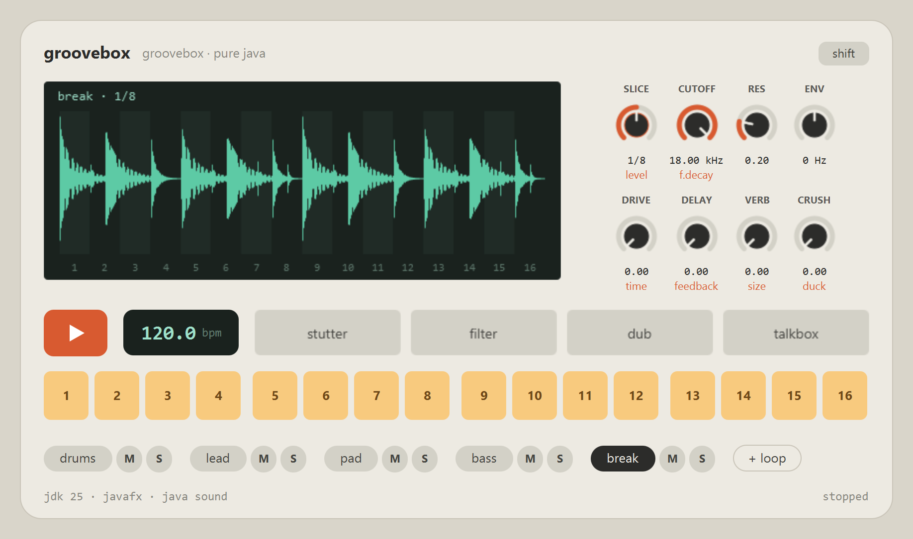
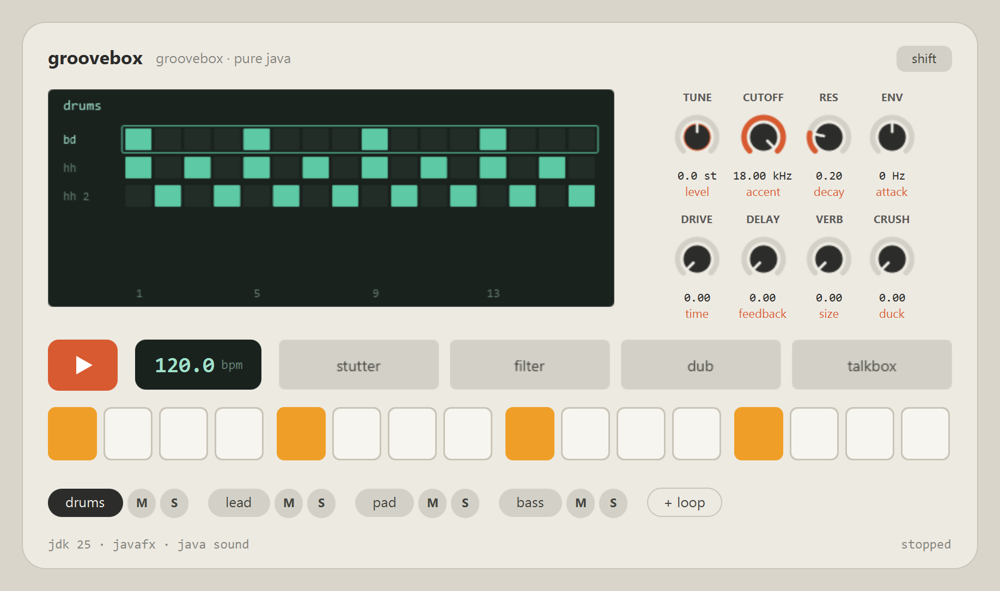
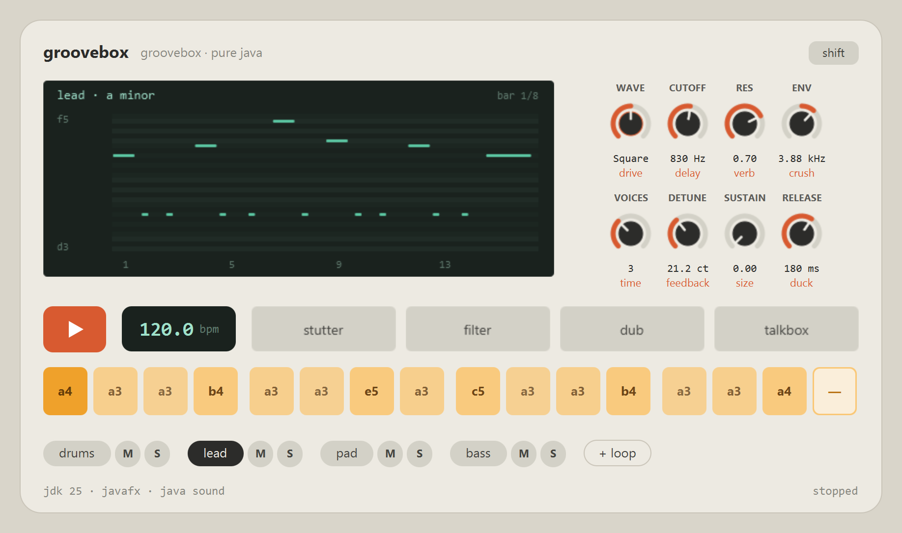
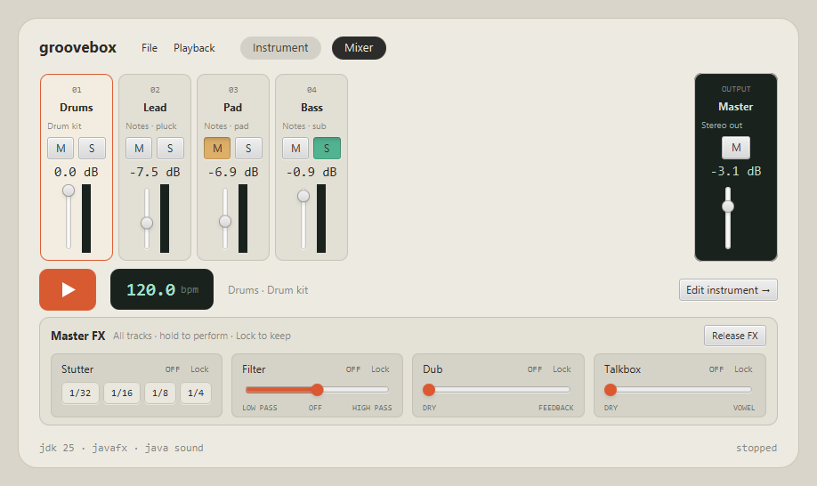

# groovebox-java

A groovebox in plain Java: sixteen pads, eight knobs and a screen, with every sound synthesized
in code. JavaFX for the box, Java Sound for the output, no native audio libraries.

Work in progress.

`./gradlew test` runs the offline suite without an audio device. `./gradlew uiGestureTest`
checks the Master FX sliders with real JavaFX mouse gestures, including right-click locking
and dragging. That additional check requires a display, opens a small window, and plays no audio.

GitHub Actions runs both checks on pull requests and pushes to `main`, using JDK 25 and a
virtual display for JavaFX. Each run uploads the offline test reports as `test-reports`.
The workflow can also be started manually from the Actions tab.



## What is in the box

- **A step-sequenced drum kit.** The screen shows the whole kit and the pads show the selected
  row's steps. A click cycles a step through its accents and a right-click empties it. Each row
  has its own tune, level, accent, decay and attack. The disco, house and dancehall patterns
  are a right-click on the drums chip away, and every drum is synthesized unless `samples/` has
  a file for it.

  

- **Synths written from scratch.** Six patches play the melodies: anthem lead, wide pad, chords,
  pluck, sub bass and acid bass. Underneath is one engine: up to seven detuned voices of a
  band-limited saw, square or sine, a diode waveshaper and a resonant filter with its own
  envelope. Its knobs change the sound while it plays. A melody, whether from the demo or a
  MIDI file, shows up as a piano roll of the bar, and each pad holds a sixteenth of it.

  

- **Loops, sliced.** `+ loop` brings in a WAV or AIFF recording, plays it in time with the jam
  and cuts it into quarters, eighths or sixteenths, one slice to a pad. Click a pad to give its
  step the next slice, drag one pad onto another, or drag a slice off the waveform. A
  right-click makes the step a rest.
- **A channel per track.** Every track goes through drive, delay, reverb and bitcrush, and
  ducks under the kick as far as you want it to. Each track has its own mute and solo.
- **A compact mixer.** The title bar switches between **Instrument** and **Mixer**, without
  changing the window size. Each channel has a volume fader, a dB readout, mute, solo and a live
  peak meter. Extra channels scroll horizontally; the master stays in view. Double-click a
  fader to restore unity gain. Track meters show the signal before effects; the master meter
  shows the finished mix. Master volume and mute control local audio, and are saved in sessions.
  Pick a channel by its name, then **Edit instrument** to return to its pads and knobs.
  Imported MIDI channels also offer **MIDI range…** directly from the mixer.

  

- **Performance strips in Mixer.** Stutter, filter, dub and talkbox act on the whole mix. Hold a strip
  using its buttons or slider, let go and the effect stops. **Lock** keeps the setting;
  right-click also toggles the lock. **Release FX** clears every lock and releases all four
  effects. Stutter offers four beat divisions, and the sliders show their direction below them.
- **MIDI in a jam.** `+ MIDI` opens a part chooser for each selected file, with a piano roll
  and audition before **Add track**. Only the chosen file track and range are added, with its own
  synth and MIDI channel; other parts are left out. Cancel leaves the jam unchanged. The jam
  keeps its tempo; its length changes only if you edit **Jam length** in the chooser.
  The track strip scrolls when more tracks are added.
  A jam can also start with a MIDI melody from a config.
  Right-click an imported track and choose **MIDI loop...** to select its file track, its **From
  bar** and **Through bar**, and whether that range repeats inside the jam. Both bar numbers are
  inclusive: 5–8 plays four bars, starting at the fifth bar of the file. Each track keeps its own
  range and repeat setting. With repeat off, the range plays once per jam pass. **Jam length**
  sets the shared pass length for all tracks; longer ranges are cut at that boundary. Changing
  the source or range keeps the track's sound, mute and solo.
  The dialog shows a file overview with the selected bars highlighted, and a piano roll of the
  range. Drag across the overview to choose bars. **Listen range** auditions the excerpt once,
  with the track's current sound, before applying it. **Stop preview**, changing the selection,
  or closing the dialog stops the audition. A playing jam pauses for the audition and resumes
  when the dialog closes; auditioning never edits the jam.
  **Start beat** and **End beat** allow exact boundaries between bar lines, counting beats from
  zero. For a pickup just before bar 2, use start **3.75** (or **3,75**); an end of **7.75** gives a
  four-beat loop. The bar fields and beat fields stay in sync. End beat is exclusive.

Nothing is shipped but code: no samples, no MIDI files, no native libraries.

## Playing it

| | |
|---|---|
| Space | play and stop |
| Click a pad | cycle a drum step, sound a melody's note, or pick a loop's slice |
| Right-click a pad | clear a drum step, or make a loop's step a rest |
| Right-click a chip | another drum pattern, another synth, another recording |
| Up / Down | the drum row above or below |
| Left / Right | turn the page of steps while stopped |
| Tab or `shift` | the knobs' second row of values, printed in orange |
| Drag the tempo | half a BPM per step, with Shift held a tenth |

## Running

Needs JDK 25 (Gradle fetches one if it is missing).

```
./gradlew run
```

The box starts with an empty drum grid and no melody tracks. Add MIDI or audio loops, or
write your own drum pattern. The title bar's **File** menu offers **New session** (Ctrl+N),
**Import MIDI...** (Ctrl+I), **Import audio loop...** (Ctrl+Shift+I), and **Load demo**.
**Playback → Play / Stop** also controls the transport. **File → Load demo** replaces the current jam with
the demo written in code: Am9 Fmaj9 Dm9 E7♭9 under a plucked lead - a
syncopated line over a ticking pedal, asked and answered over eight bars - echoing on the dotted
eighth, a pad pumping under the kick, a sub bass and a disco
beat. Press space to play.

**File → Load drum samples folder...** replaces the drum sounds during playback, leaving the
notes and tracks in place. Pick a folder containing WAV files with these names (case does not matter):

| Drum | File names |
| --- | --- |
| Kick | `bd.wav` or `kick.wav` |
| Snare | `sd.wav` or `snare.wav` |
| Closed hi-hat | `hh.wav`, `closed-hat.wav`, `closed_hat.wav`, or `hihat.wav` |
| Open hi-hat | `oh.wav`, `open-hat.wav`, or `open_hat.wav` |
| Clap | `cp.wav` or `clap.wav` |

The short name takes priority when both are present. Missing sounds are synthesized; a report
shows which files were loaded. An empty, unrecognized or broken kit leaves the previous kit intact.
The chosen kit stays active for this app run, including new sessions and the demo, and its
folder is restored when a saved session is opened.

## Session files

**File → Save session** (Ctrl+S) writes the entire workspace to a UTF-8 `.properties` file.
**Save session as...** (Ctrl+Shift+S) chooses another file; **Open session...** (Ctrl+O)
restores it and leaves playback stopped. A failed open leaves the current workspace intact.
Opening a session starts a fresh undo history.

The document extends the single-MIDI `jam.properties` format with `session.version=1`,
`bpm`, `bars`, `key`, `scale`, `chords`, `code`, `tracks.count` and numbered `track.0.*`
and `row.0.*` properties. It keeps track names and order, selection, gain, mute and solo,
MIDI source tracks and exact beat ranges, repeat settings, edited notes, audio loops and their
slice order, every synth and effect parameter, delay synchronization and each instrument's
external MIDI routing. The drum grid includes accents, tuning, envelopes and row effects.
A custom drum kit's folder is also saved.

MIDI, audio and drum samples remain external files, with paths relative to the session file
where possible. Move those files together with the session to keep the project usable.
Edited notes and demo notes are written into the session itself. Older single-MIDI configs
with `file`, `track`, `fromBar`, `bars`, `synth` and `drums` can still be opened, using the
patches and drum patterns available in this app; saving them writes the full session format.
`--config` accepts both formats.
MusicJam's `shape`, `worry`, `dre`, `giorgio` and `insomnia` pattern names are recognized.
Older project-relative MIDI paths are searched from the config's directory and its ancestors,
so the examples under `../musicjam/src/main/resources` can be opened directly.
The old `loops` option belongs to MusicJam's finite playback; this box repeats until Stop.

A jam can also start from a config naming a MIDI file for its melody:

```
./gradlew run --args="--config path/to/jam.properties"
```

```
file=song.mid
track=1
bars=2
synth=pluck
drums=disco
```

## License

MIT
